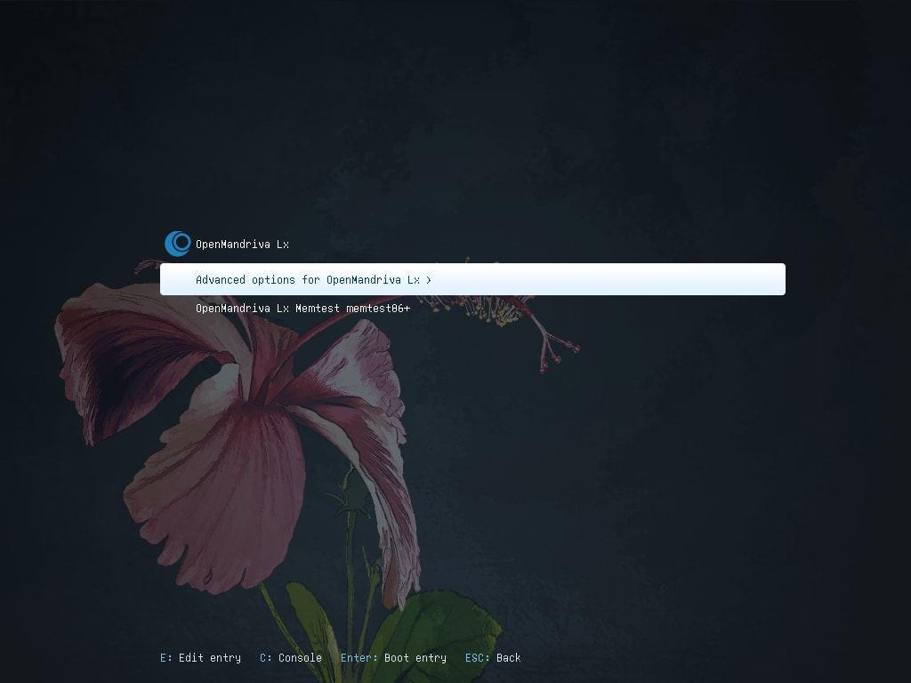
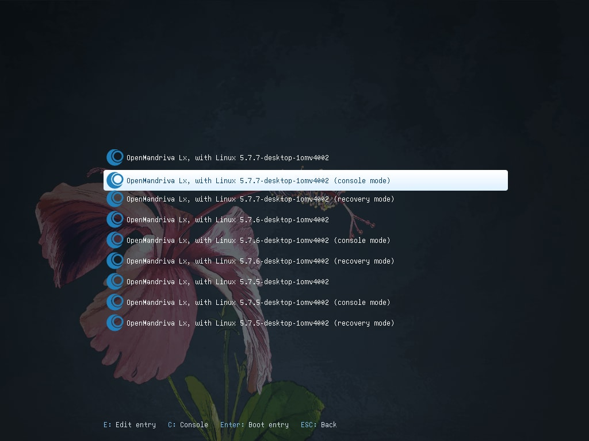
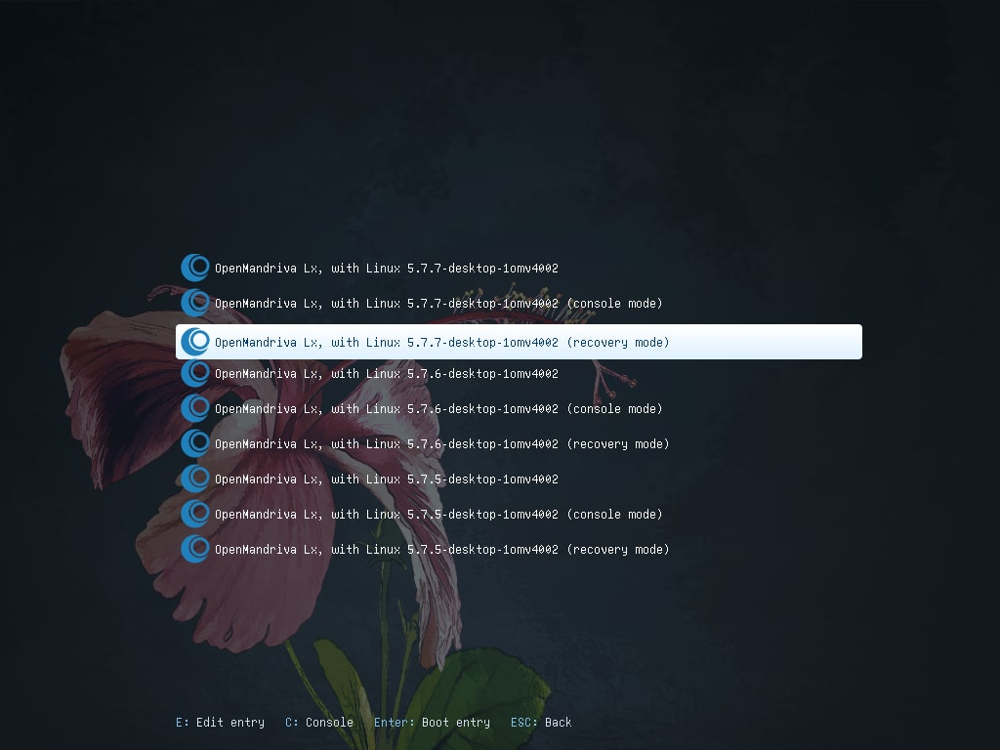

# Как подключиться к Интернету в консольном режиме или режиме восстановления


> Примечание: В этой инструкции предполагается, что подключение к Интернету ранее работало исправно, но затем возникла проблема.
{.is-info}


Иногда для обслуживания или восстановления системы может потребоваться загрузиться в консольном режиме или режиме восстановления вместо рабочего стола Plasma.








В этих режимах подключение к Wi-Fi может не работать.

## Wi-Fi
Для подключения к Wi-Fi через командную строку используется команда `nmcli`. Пример:

Чтобы определить, какое устройство использовать для подключения, выполните следующую команду:

```
$ nmcli dev status
```

Эта команда выведет список всех доступных сетевых устройств. В нашем примере для подключения используется Wi-Fi, а не Wi-Fi P2P. Команда показывает, что беспроводной интерфейс имеет имя wlp4s0. Чтобы подключиться, выполните следующую команду:

```
$ nmcli --ask dev con wlp4s0
```

После выполнения команды система должна запросить пароль от сети Wi-Fi и установить подключение.
Теперь вы можете выполнять обслуживание и восстановление системы, требующие доступа к Интернету.

## Подключение по Ethernet

Если вы используете проводное подключение Ethernet, процедура подключения практически не отличается:

```
$ nmcli dev status
```

Если ваш сетевой интерфейс Ethernet указан, например, как elp4s0:

```
$ nmcli dev con elp4s0
```

Параметр `--ask` обычно не требуется, поскольку система уже имеет необходимые разрешения для подключения.
Разрешения на подключение к Wi-Fi, как правило, настраиваются отдельно и отличаются от системных разрешений.

\-


