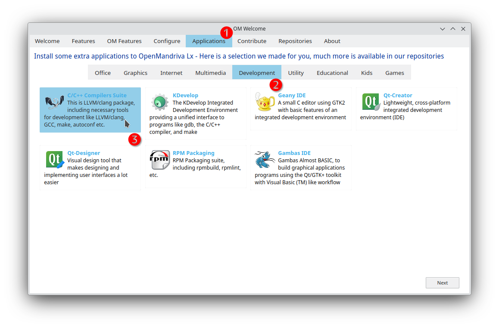

# Clang
Одной из отличительных особенностей OpenMandriva является использование *clang* в качестве основного компилятора.

> GCC по-прежнему доступен, однако начиная с OpenMandriva 5.0 он был полностью заменён на CLANG в качестве основного компилятора.
> Например, теперь использовать gcc для компиляции модулей ядра невозможно! {.is-warning}

## Начало работы

1. Прежде чем самостоятельно компилировать ПО, убедитесь, что оно ещё не доступно в одном из наших репозиториев.
2. Вы также можете обратиться к нашей команде с просьбой добавить пакет через форум или непосредственно на GitHub.

## Быстрый старт

Вы можете установить основные инструменты разработки через приложение OM Welcome:


В командной строке можно ввести следующую команду:

```bash
sudo dnf install task-devel task-c-devel task-c++-devel
```

Пример команды make для локальной компиляции ПО на вашем компьютере:

## Компилятор

По умолчанию некоторые программы могут использовать GCC для компиляции. Вместо него следует попробовать Clang.
Ниже приведён пример команды make с пользовательскими параметрами:

```bash
make CC=clang CXX=clang++ LD=ld.lld AR=llvm-ar NM=llvm-nm OBJCOPY=llvm-objcopy OBJSIZE=llvm-size STRIP=llvm-strip -C ...
```

## Создание пакетов

Если вы хотите продолжить работу в этом направлении, приглашаем присоединиться к нашей команде по созданию и сопровождению пакетов ПО.