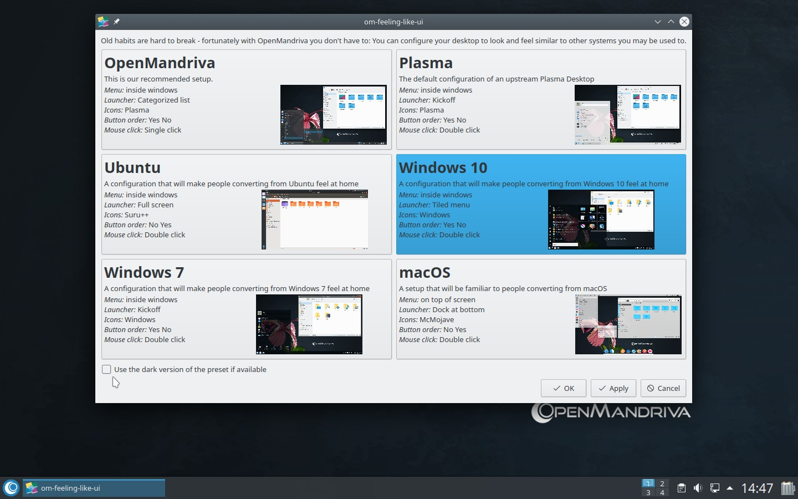
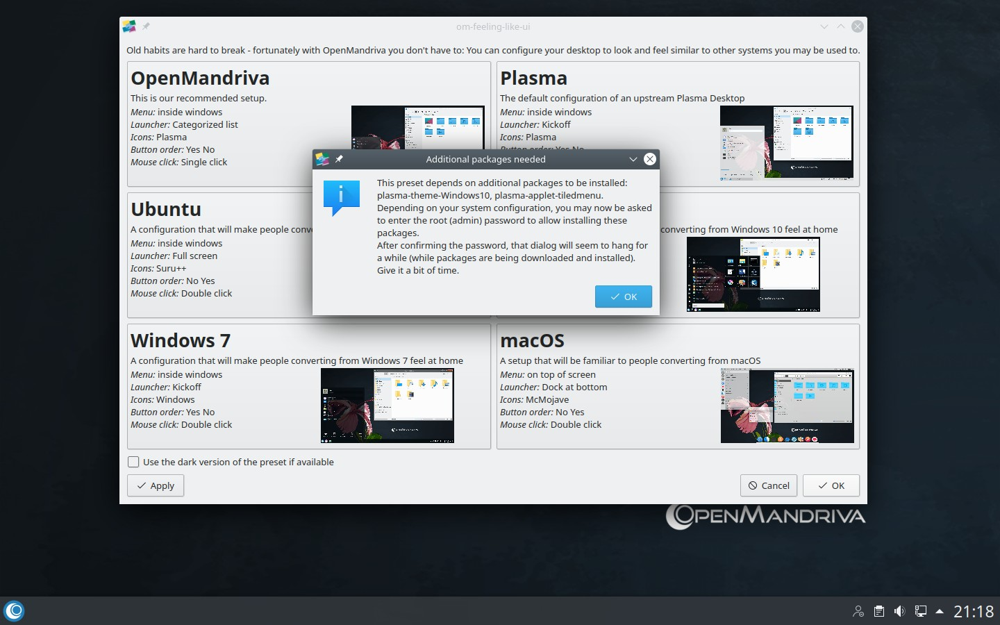
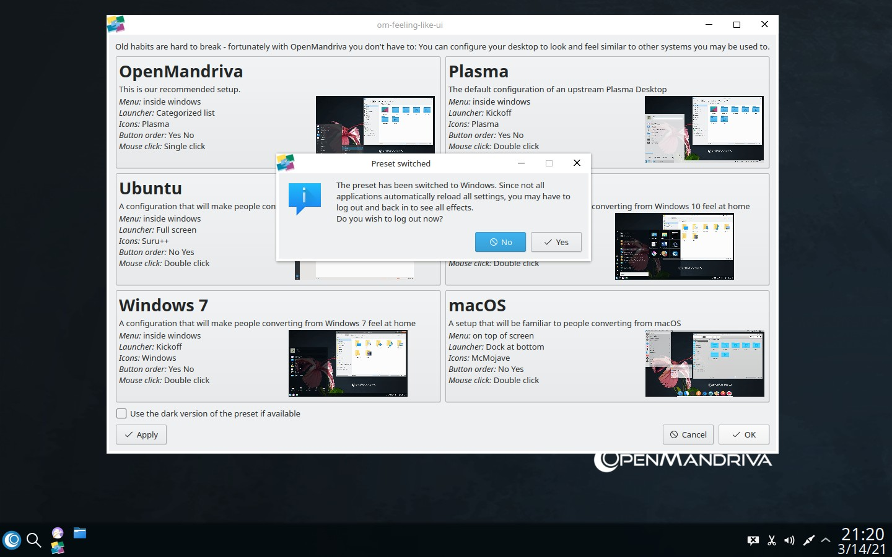
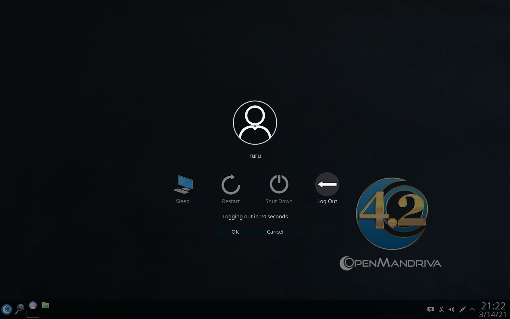
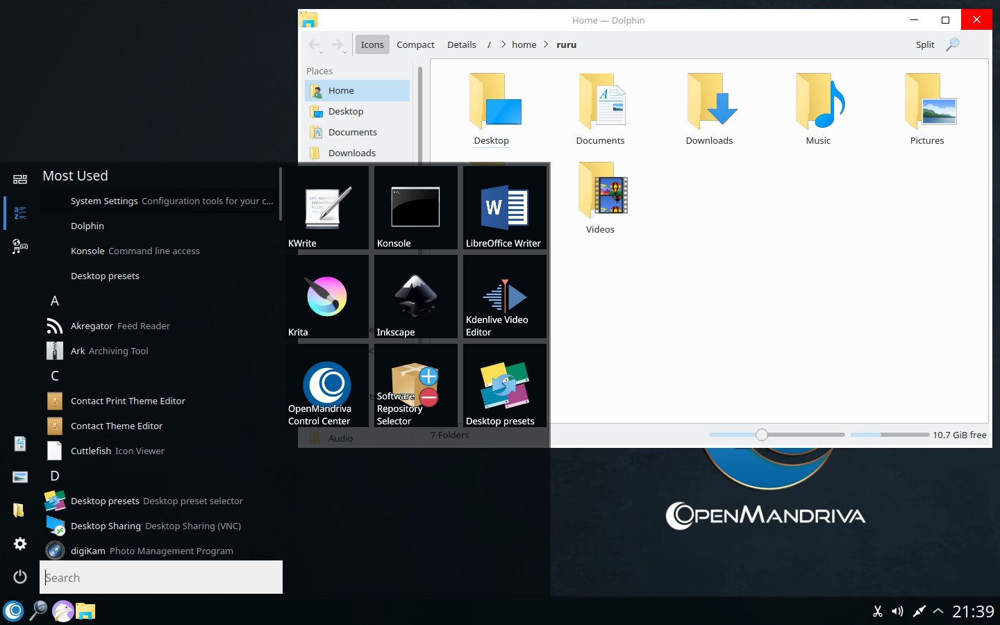
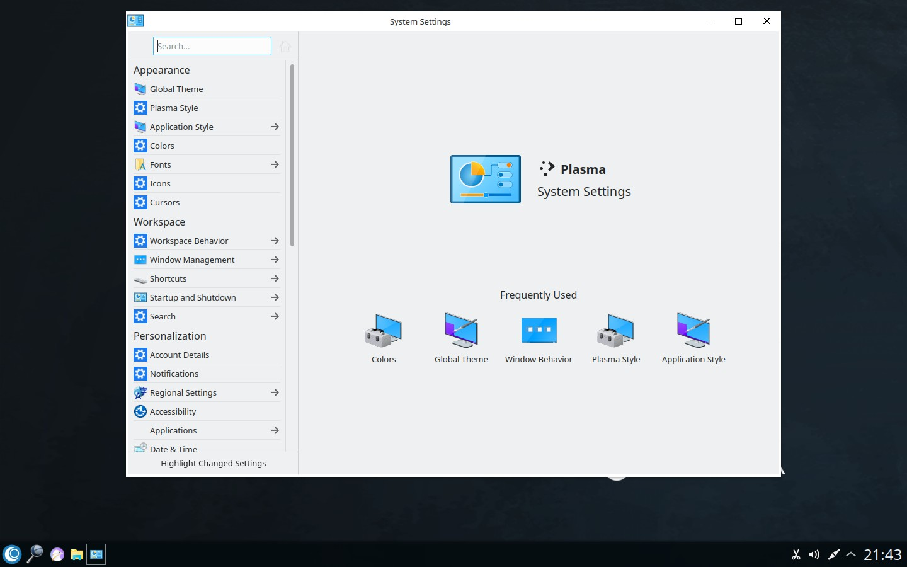

# Как настроить рабочий стол в стиле Windows 10 (готовые настройки рабочего стола)
> Desktop Presets (om-feeling-like) — это инструмент для настройки внешнего вида и поведения рабочего стола Plasma в OpenMandriva, позволяющий сделать его похожим на другие привычные вам операционные системы.
{.is-info}

Если вы ранее пользовались Windows и хотите, чтобы рабочий стол OMLx выглядел как Windows 10, выполните следующие действия:

### Меню приложений > Настройки > Готовые настройки рабочего стола

### Или откройте OM Welcome и перейдите в раздел OM Features > Готовые настройки рабочего стола

### Выберите готовый профиль Windows 10
- Если вы предпочитаете тёмные темы оформления, выберите «*Использовать тёмный вариант оформления, если он доступен*».

Во всплывающем окне появится информация о пакетах, которые будут установлены
- Также появится уведомление о том, что процесс установки может занять некоторое время

### При появлении запроса введите пароль суперпользователя root

### Дождитесь завершения всех операций.
- Появится новое всплывающее окно с предложением выйти из системы, чтобы все новые настройки вступили в силу

### Подтвердите действие и выйдите из системы

### Войдите в рабочую среду Plasma, оформленную в стиле Windows 10.

\- 

