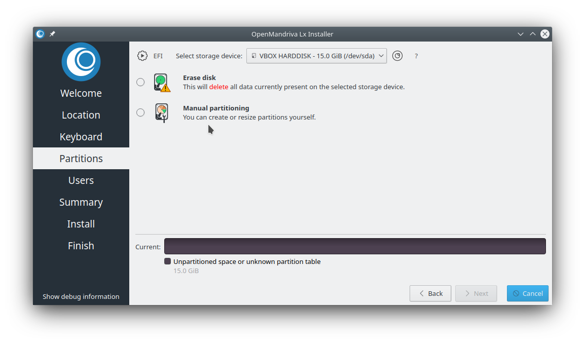
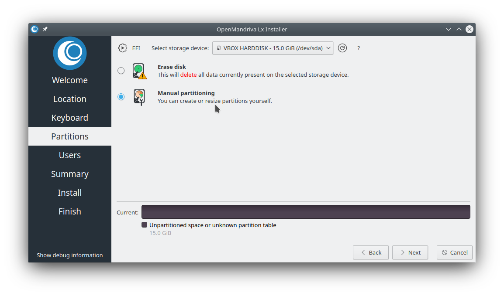
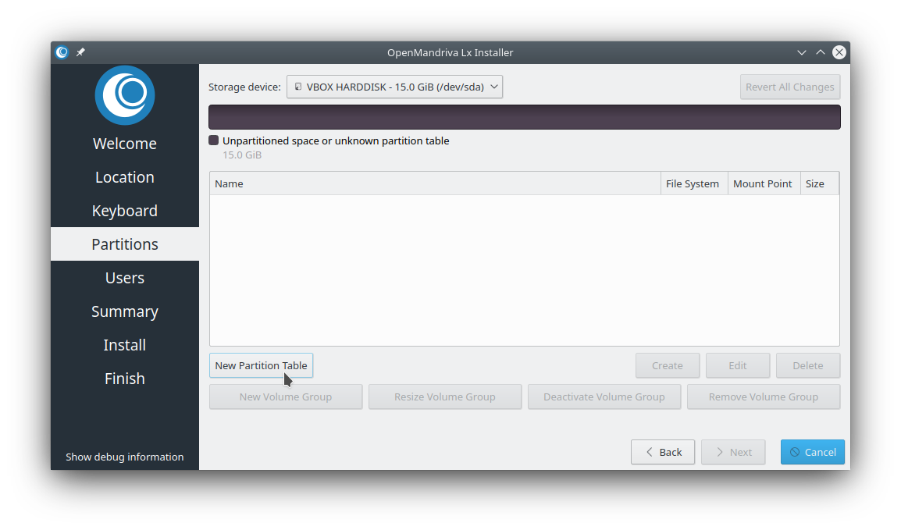
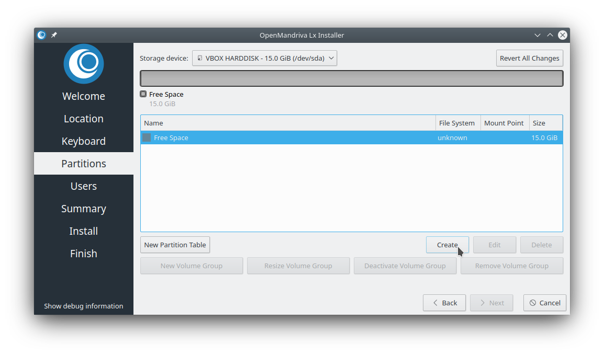
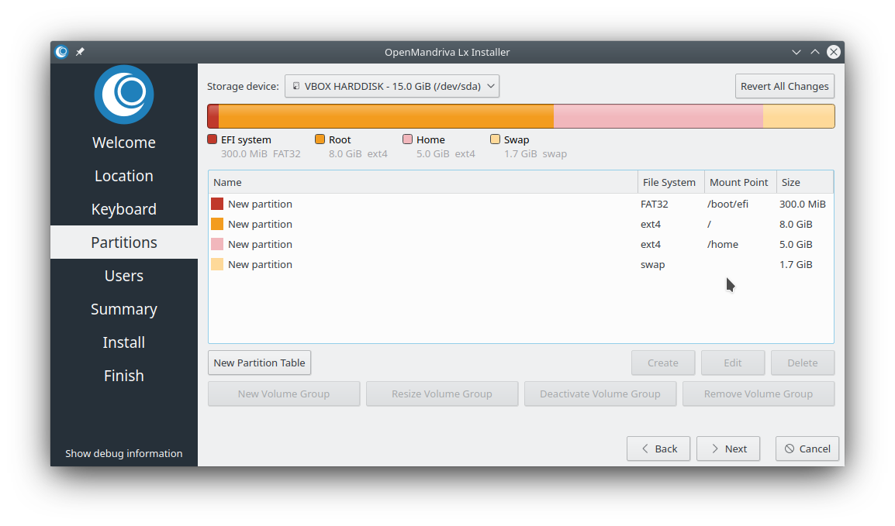
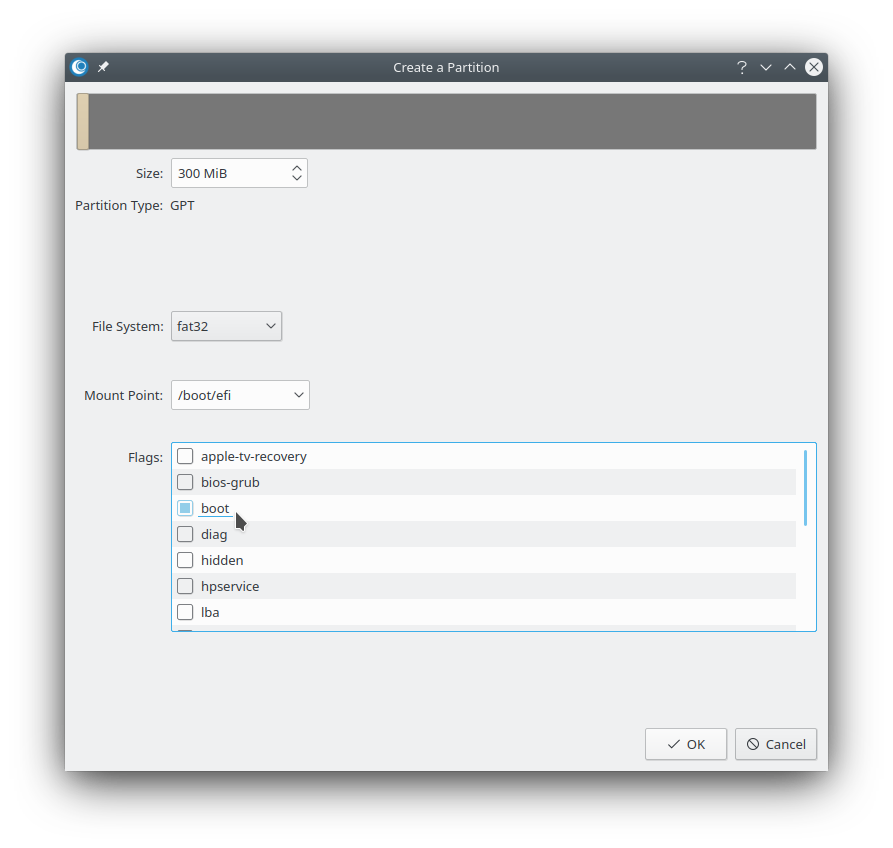

# Как создать корневой раздел, раздел /home и раздел подкачки при установке OMLx

Установщиком OpenMandriva является [Calamares](http://calamares.io/).
Он отличается простотой, удобством использования, привлекательным интерфейсом, практичностью, доступностью для всех пользователей и независимостью от конкретного дистрибутива.
Calamares включает расширенные средства разметки диска с поддержкой как ручного, так и автоматического управления разделами.

> Примечание: Под обозначением *Lx 4* подразумеваются все версии ветки 4.x, включая 4.0, 4.1 и 4.2. Эта инструкция применима ко всем версиям OMLx, включая Cooker и Rolling, а также семейство Lx 4.
{.is-info}

Для выполнения практически любых операций с разделами диска необходимо выбрать <kbd>Ручная разметка</kbd>

Обратите внимание, что если оставить выбранный по умолчанию вариант <kbd>Стереть диск</kbd>, будут созданы только разделы `/boot/efi` и `/`.
По умолчанию установщик больше не создаёт раздел подкачки автоматически, поскольку на большинстве современных компьютеров он уже не используется.

Выберите <kbd>Ручная разметка</kbd>

Сначала рассмотрим настройку системы EFI с отдельными разделами `/`, `/home` и `swap`, а также необходимым для загрузки в режиме EFI разделом `/boot/efi`. Если используется таблица разделов MBR, создавать раздел `/boot/efi` не требуется.
Раздел `/boot/efi` должен иметь флаг `boot`. (Программа разметки автоматически установит для него флаг `esp`.)

Первым шагом выберите <kbd>Новая таблица разделов</kbd>
Если система загружается в режиме EFI или UEFI, необходимо использовать таблицу разделов `GPT`.
При загрузке в режиме Legacy BIOS можно выбрать как `MBR`, так и `GPT`. Если вы не знаете, какой вариант использовать, выберите более современный `GPT`. Кроме того, если на компьютере установлено несколько жёстких дисков или SSD, все они должны использовать один тип таблицы разделов, иначе могут возникнуть проблемы. Поэтому на всех накопителях должна использоваться либо `GPT`, либо `MBR`.

Далее создадим разделы `/boot/efi`, `/`, `/home` и раздел подкачки в указанном порядке.
Единственное важное условие при выборе порядка: раздел `/boot/efi` должен быть первым. Остальные разделы можно создавать в любом порядке.

Раздел `/boot/efi` обычно имеет размер 300 МБ и для корректной работы должен использовать файловую систему FAT16 или FAT32. В некоторых других установщиках этот тип файловой системы обозначается как vfat.

Итак, будем создавать разделы по одному.
Нажмите кнопку <kbd>Создать</kbd>

Следуйте инструкциям в диалоговом окне. В результате у вас должно получиться примерно следующее:

Если разметка диска соответствует вашим требованиям, нажмите <kbd>Далее</kbd>. После завершения установки в новой системе будут отдельные корневой раздел, раздел `/home` и раздел подкачки `swap`.

Обратите внимание, что раздел `/boot/efi` находится первым в списке. Это обязательное условие.

> Обратите внимание, что раздел подкачки, скорее всего, никогда не будет использоваться. В настоящее время он действительно необходим лишь небольшому числу пользователей. Те, кому требуется раздел подкачки, обычно знают об этом и могут настроить его в соответствии со своими потребностями. Как правило, раздел подкачки может понадобиться на очень старых компьютерах, которым изначально не хватает оперативной памяти для работы Lx 4. Сколько оперативной памяти достаточно? В идеале — 4 ГБ. Однако некоторые пользователи успешно запускают Lx 4 и с 2 ГБ. В примечаниях к выпускам Lx 4.0 и 4.1 указано минимальное требование в 2 ГБ, и установщик Calamares также требует не менее 2 ГБ. В настоящее время увеличение объёма оперативной памяти на настольном компьютере или ноутбуке обычно не представляет сложности и обходится сравнительно недорого. Поэтому, если вашему компьютеру не хватает памяти, рассмотрите возможность её увеличения.
Раздел подкачки также может использоваться на компьютерах, выполняющих особенно ресурсоёмкие математические или научные вычисления, а также при работе с требовательными графическими приложениями. Однако пользователи таких систем, как правило, сами знают, какие ресурсы им необходимы.
{.is-info}

На этом снимке экрана показано, как должно выглядеть диалоговое окно <kbd>Создать</kbd> при создании раздела `/boot/efi` в системе с `UEFI/EFI`:

\-
