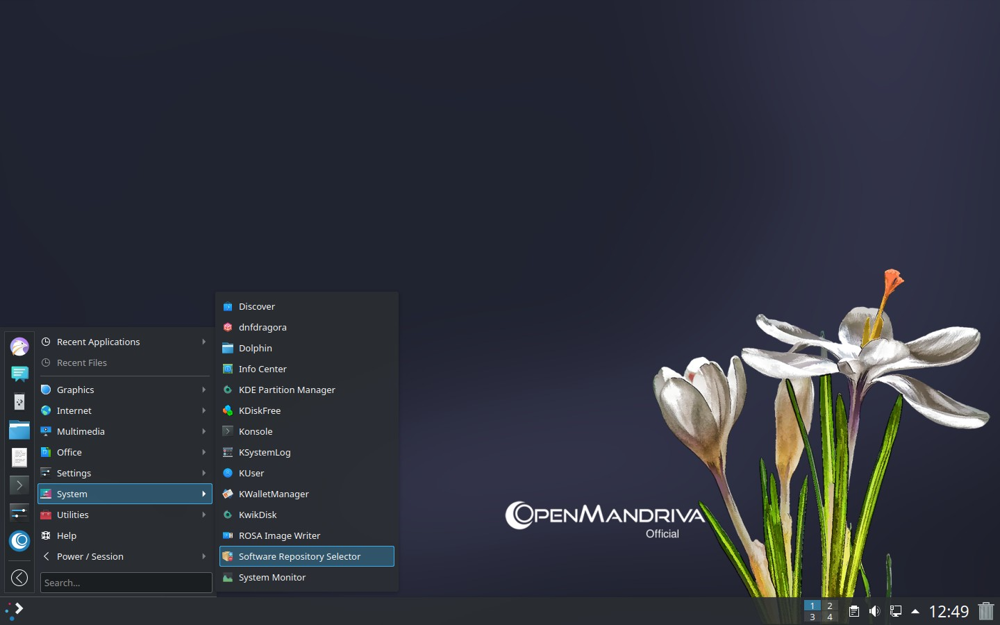
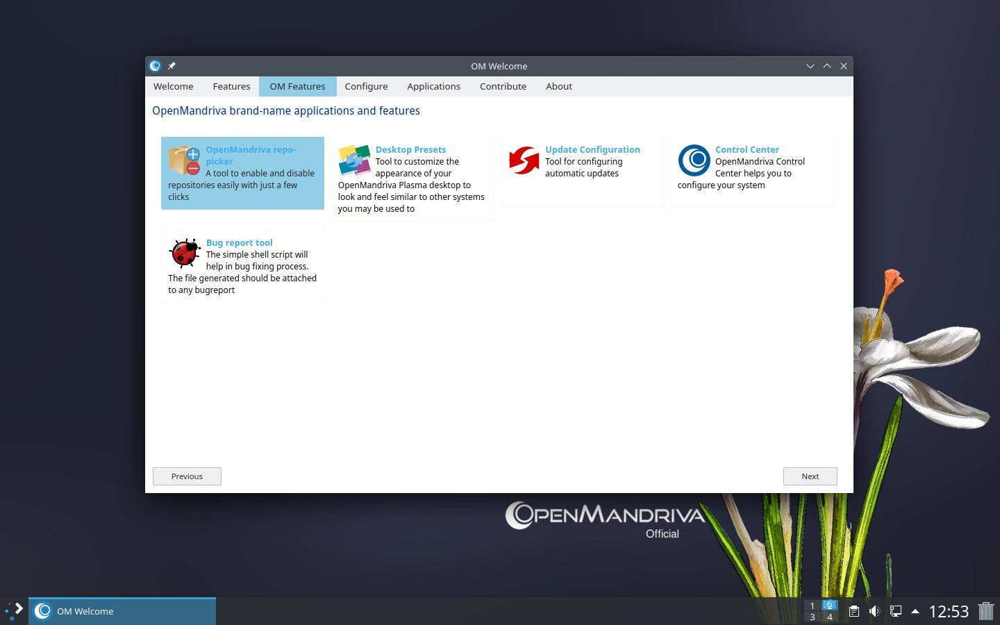
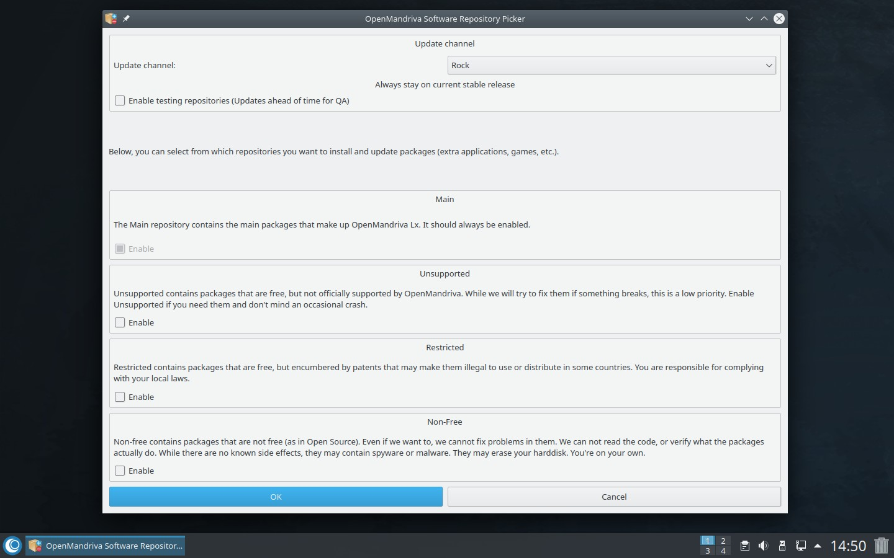
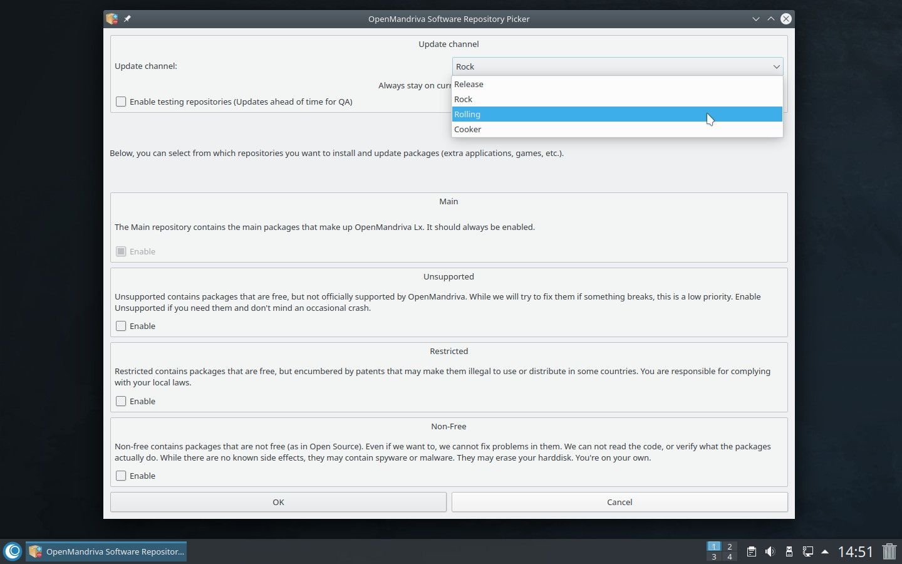

# Как изменить канал обновлений
## Как перейти с Rock на ROME (непрерывные обновления)

Пользователям, впервые знакомящимся с OpenMandriva Lx, мы рекомендуем начать со стабильного выпуска Rock, чтобы освоить работу с системой. В дальнейшем при желании можно перейти на ROME - редакцию с непрерывными обновлениями.

Как *пользователь ROME*, вы должны уметь работать с командной строкой и знать основы использования пакетного менеджера [dnf](/en/distribution/guides/software-management/DNF).
Также необходимо прочитать и понять документ [План выпусков и репозитории OpenMandriva](/en/policies/release-plan-and-repositories).

Для перехода на ROME:

- Откройте инструмент выбора репозиториев Software Repository Selector (`om-repo-picker`)
Меню приложений > Выбор репозиториев



или выберите OpenMandriva repo-picker в приложении OM Welcome




- Перейдите в самый первый раздел «Канал обновлений».



- Выберите «Rolling» в раскрывающемся списке



Подтвердите выбор, нажав ОК и при появлении запроса введите пароль суперпользователя root. Процесс может занять некоторое время, а окно программы может временно исчезнуть с экрана. Дождитесь завершения операции.

После этого репозитории Rock будут заменены на Rolling. Теперь необходимо выполнить обновление системы (`distro-sync`).

- Чтобы обновить систему, откройте Konsole и выполните следующие команды:
```
$ sudo dnf clean all ; dnf clean all ; dnf repolist
$ sudo dnf --allowerasing distro-sync
```

\-
