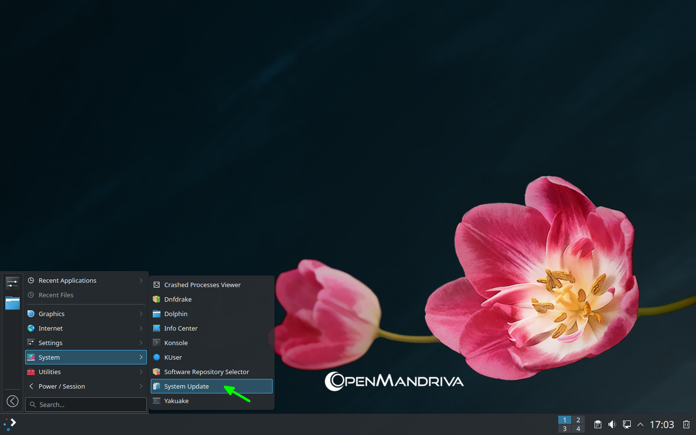
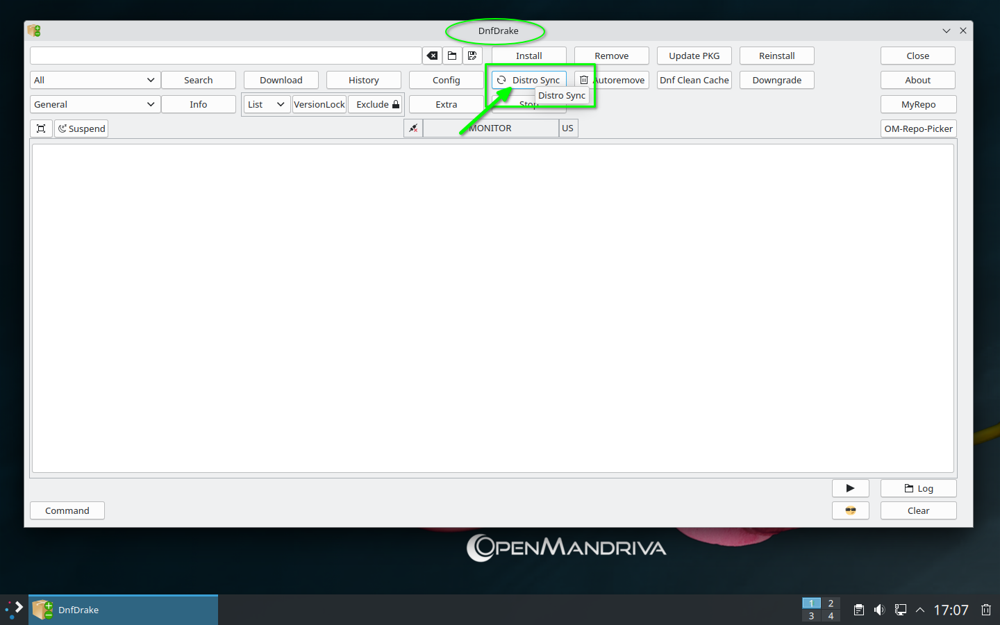

# Как обновить систему

> В OpenMandriva действует особый порядок обновления системы.
> **Не используйте** Discover для обновления системы.
{.is-danger}

<br>


Откройте Konsole и выполните следующие команды:
```
$ sudo dnf clean all ; dnf clean all ; dnf repolist
$ sudo dnf distro-sync --refresh --allowerasing
```

- или




- или


- или


