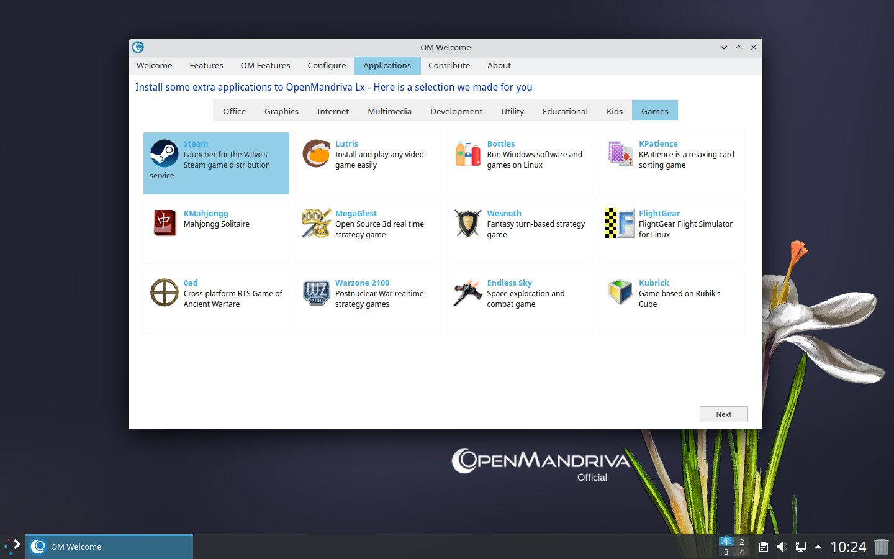
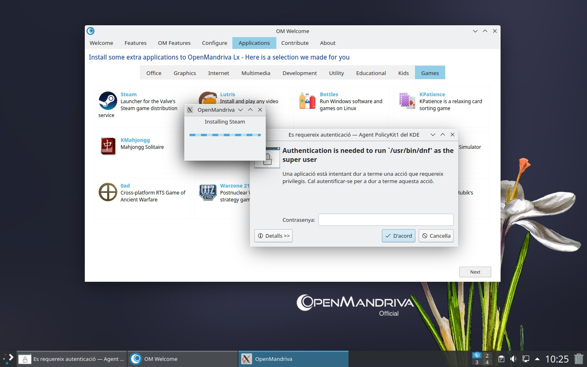
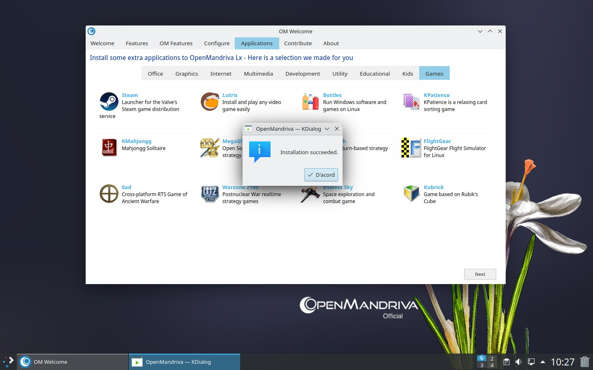
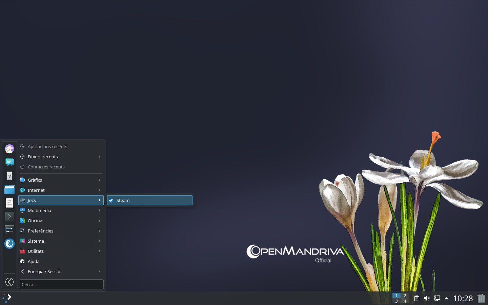
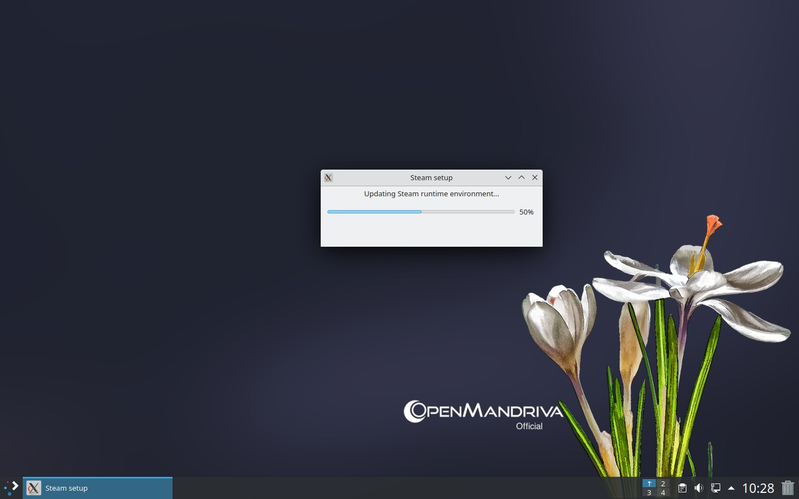
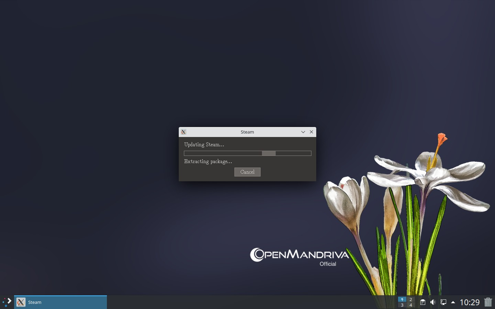
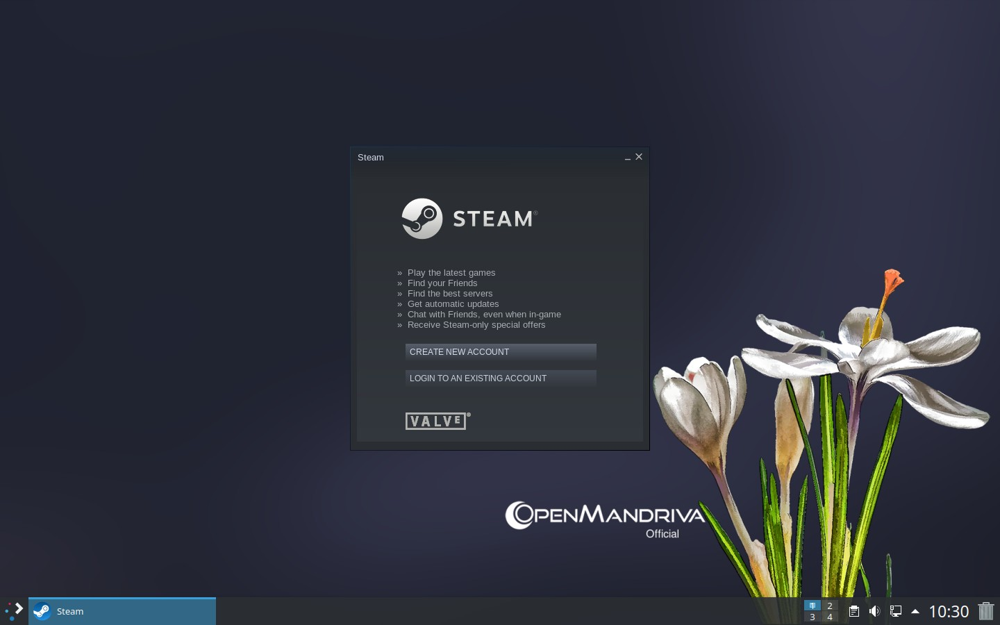
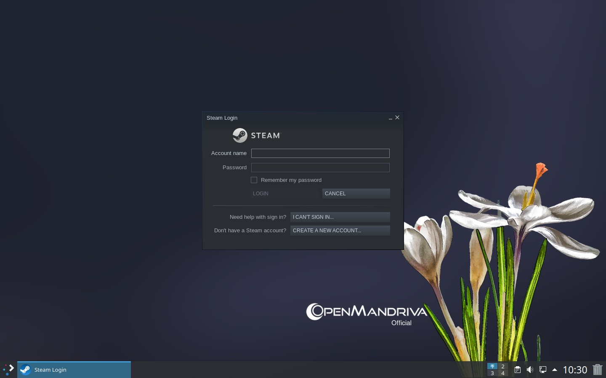
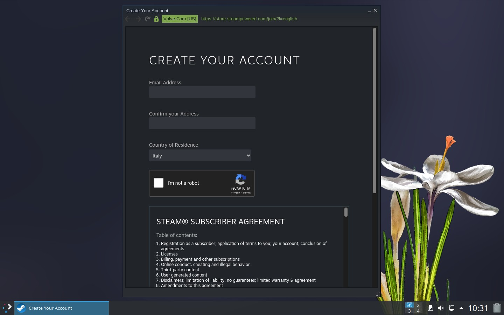

# Как установить Steam в OpenMandriva

## Чтобы установить Steam в OpenMandriva Lx, выполните следующие действия:

### Добро пожаловать > Приложения > Игры

Нажми на Steam

### Меню приложений > Игры > Steam

Если вы используете драйвер NVIDIA, необходимо также установить его 32-битную версию.

`$ sudo dnf clean all;dnf clean all;dnf repolist`

Затем выполните:
`$ sudo dnf install --enablerepo=rock-x86_64-non-free nvidia-32bit`
или
`$ sudo dnf install --enablerepo=rock-x86_64-non-free nvidia-legacy-32bit`

