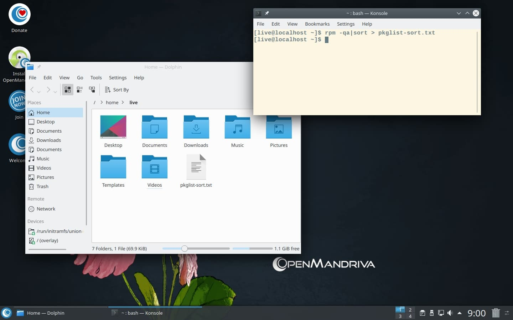

# Как получить список всех пакетов, включённых в ISO-образ


В Live-режиме откройте терминал и введите:

```
rpm -qa|sort > pkglist-sort.txt
```
В результате в вашем домашнем каталоге `/home` будет создан обычный текстовый файл с именем `pkglist-sort.txt`.

Список пакетов отсортирован по алфавиту от A до Z.



> Этот простой способ работает не только в ISO/Live-режиме, но и в установленной системе.
> Вы можете выполнять эту команду в любое время, когда потребуется.
{.is-info}


Если вы хотите получить список всех пакетов, отсортированный по дате, введите:

```
rpm -qa --last > pkglist-last.txt
```

