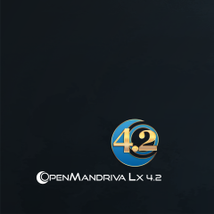
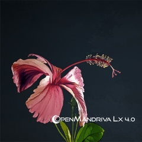
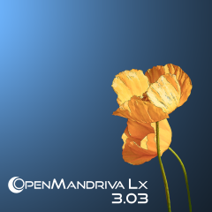

# Выпуски OpenMandriva

## Актуальные выпуски
 

### [OpenMandriva ROME](/distribution/releases/rome)

**OpenMandriva с непрерывными обновлениями**
1 выпуск: в сентябре 2022 года
 

### [OpenMandriva Lx 6.0](/distribution/releases/omlx60/)

**Кодовое имя Vanadium**
Релиз: Апрель 2025
 

## Предыдущие выпуски

### [OpenMandriva Lx 5.0](/distribution/releases/omlx50/)

**Кодовое имя Iodine**
Релиз: 25 Ноября 2023
 

### [OpenMandriva Lx 4.3](/distribution/releases/omlx43/)

**Кодовое имя Dysprosium**
Релиз: 07 Февраля 2022
 

## Предыдущие выпуски

### OpenMandriva Lx 4.2

Кодовое имя Argon
Релиз: 12 Февраля 2021
 

### OpenMandriva Lx 4.1

Кодовое имя Mercury
Релиз: 02 Февраля 2020
 

### OpenMandriva Lx 4.0

Кодовое имя Nitrogen
Релиз: 19 Июня 2019
 

### OpenMandriva Lx 3.3

Кодовое имя Einsteinium
Релиз: 21 Ноября 2017
 

### OpenMandriva Lx 2014.2 (Наследник)

Кодовое имя Phosphorus
Релиз: 29 Июня 2015
 

### OpenMandriva Lx 2013

Кодовое имя: Oxygen
Дата выпуска: 22 ноября 2013 года
OpenMandriva Lx 2013.0 — первый выпуск Ассоциации OpenMandriva и преемник Mandriva Linux 2011.
 

{.align-abstopright}
