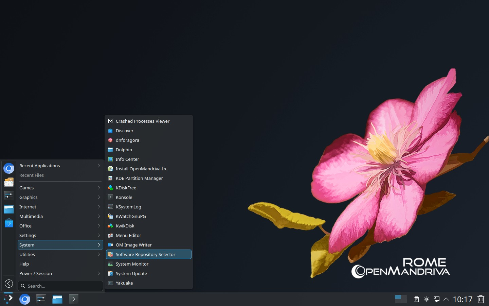
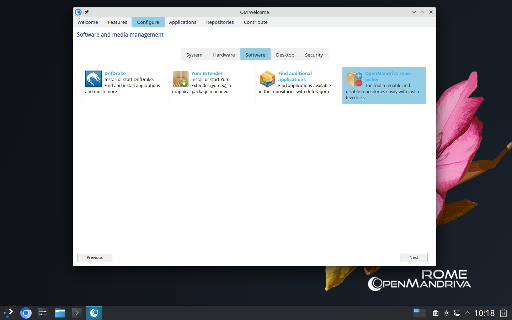
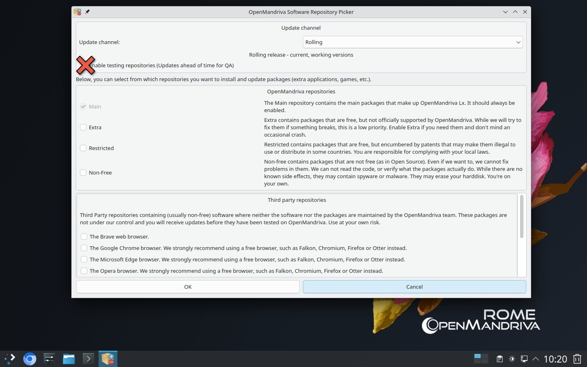
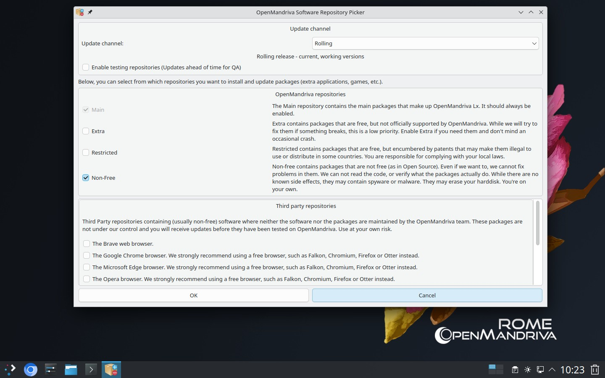
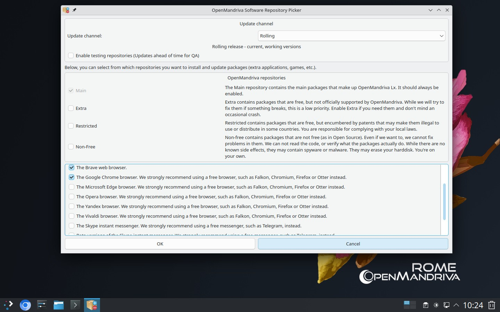

# Менеджер репозиториев ПО

## Как управлять репозиториями с помощью om-repo-picker

Меню приложений > Менеджер репозиториев ПО (om-repo-picker)

или выберите OpenMandriva repo-picker в OM Welcome

## Источники ПО
У нас есть четыре основных источника ПО: `/main`, `/extra`, `/restricted` и `/non-free`

### main
`/main` содержит основные пакеты, сопровождаемые командой OpenMandriva Lx.
Сюда входят все пакеты, включённые в установочные образы, а также множество других важных приложений. Репозиторий `/main/release` должен быть всегда включён.

**Обычным пользователям никогда не следует включать репозитории** `/testing` **в стабильном выпуске**.

Если по какой-либо причине обычному пользователю потребуется их включить, он делает это на свой страх и риск.

### extra
`/extra` содержит пакеты, сопровождаемые сообществом. Они не поддерживаются основной командой OpenMandriva Lx, а их обновление зависит от сопровождающих пакетов.
В этом репозитории можно найти множество полезных и актуальных пакетов, но некоторые из них могут не устанавливаться или работать некорректно после установки. Пользователи могут свободно использовать любые пакеты из этого репозитория, которые работают должным образом.
#### Как включить репозиторий extra в om-repo-picker

### restricted
`/restricted` содержит библиотеки, которые не устанавливаются по умолчанию из-за юридических ограничений, в том числе связанных с патентами.
Правила использования этих пакетов различаются в зависимости от страны. OpenMandriva Lx не несёт ответственности за их использование. Если вы считаете, что использование этих пакетов запрещено в вашей стране, отключите репозитории restricted.
#### Как включить репозиторий restricted в om-repo-picker

### non-free
`/non-free` содержит приложения и драйверы, которые распространяются, но не соответствуют определению свободного ПО.
Хотя мы можем изменять способ упаковки таких приложений в пакеты, у нас нет доступа к их исходному коду, поэтому мы не можем исправлять проблемы, вызванные программным обеспечением из этого репозитория.
#### Как включить репозиторий non-free в om-repo-picker

### Сторонние репозитории
При необходимости вы также можете включить сторонние репозитории

## После внесения изменений
После внесения всех изменений выполните в терминале следующую команду:
`$ sudo dnf clean all ; dnf clean all ; dnf repolist`

## Подробнее
Подробную информацию см. в статье [План выпуска OpenMandriva и репозитории](/policies/release-plan-and-repositories)

\- 

