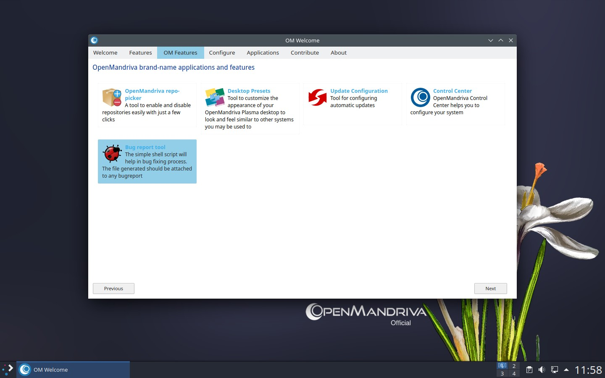
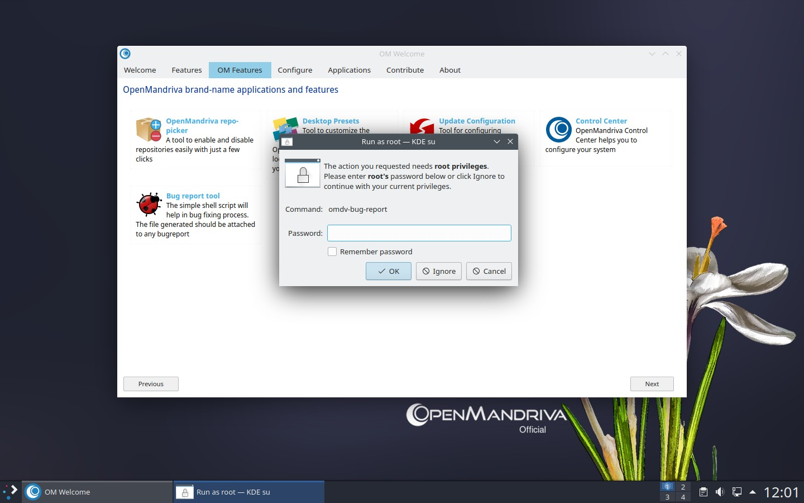
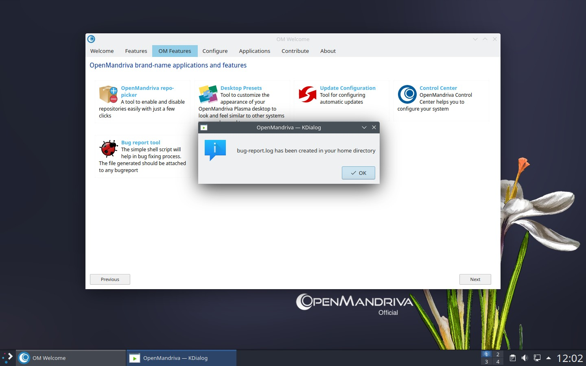
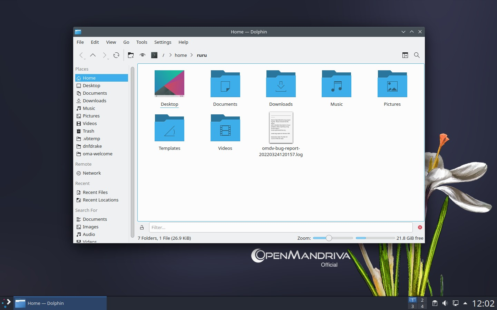

# Инструмент создания отчётов об ошибках OpenMandriva Lx
Эта простая утилита называется om-bug-report.

## Быстрый доступ
### Откройте Добро пожаловать и перейдите в раздел Возможности > *Bug report tool*.

## Собираемая информация
Утилита собирает полезную информацию из следующих источников:

- Различные конфигурационные файлы (в /etc/*)
- Различные записи в /proc (содержащие информацию о конфигурации ядра)
- Конфигурация grub (загрузчика системы)
- Вывод lspcidrake (список устройств PCI)
- Вывод lsusb (список устройств USB)
- Вывод dmidecode (информация об оборудовании из BIOS)
- Вывод systemctl –failed (сведения о системных компонентах и службах, запуск которых завершился ошибкой)
- Вывод journalctl -b (журнал текущей загрузки системы)
- Вывод rpm -qa (список установленных пакетов)
- Версия gcc (версия компилятора)

После сбора информации утилита создаст файл omdv-bug-report в вашем каталоге /home.

> **Этот файл необходимо прикладывать к каждому отчёту об ошибке**.
{.is-info}

Это поможет ускорить работу специалистов по устранению ошибок и упростит подготовку отчётов, позволяя быстро предоставить подробную информацию о системе.

\- 

